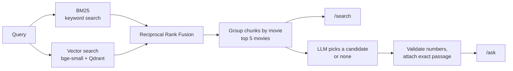

# Movie Finder

A RAG system that answers "what was that movie?" from a vague description. It retrieves plot passages with hybrid search (BM25 + vectors), and an LLM picks the matching movie **only from the retrieved candidates**, quoting the passage that supports it, or says none fit.

The pipeline is config-driven, so chunking, embedding and retrieval methods can be swapped and **measured** on a reviewed test set.

**Stack:** Python, FastAPI, Qdrant, sentence-transformers, rank-bm25, Groq (GPT-OSS models), Docker Compose, pytest

## Example

`POST /ask`

```json
{ "query": "a palanteologist goes fossil hunting with his niece" }
```

```json
{
  "match": {
    "movie_id": "walking_with_dinosaurs_2013",
    "title": "Walking with Dinosaurs",
    "year": 2013
  },
  "explanation": "The passage describes a paleontologist named Zack taking his niece Jade (and nephew Ricky) on a fossil hunt, matching the description.",
  "passage": "A paleontologist named Zack takes his nephew Ricky and niece Jade on a fossil hunt. ...",
  "candidates": ["...5 retrieved movies with their passages..."]
}
```

The typo in the query still works, because the vector search matches meaning, not exact words. For a movie that isn't in the data, `match` is `null`.

## Architecture



- **Indexing:** plots are split into 200-token chunks with 40-token overlap, using the embedding model's own tokenizer so no chunk exceeds its input limit.
- **Retrieval:** BM25 and vector results are merged with RRF (k=60), then grouped so each movie appears once, ranked by its best chunk.
- **Grounded answers:** the LLM returns only numbers (which candidate, which passage). The code checks them and fills in the title and passage from the retrieved data, so the quote is always verbatim and the movie is always one that retrieval found. Invalid output is rejected (`502`), never shown.
- **Swappable components:** chunker, embedder, retriever and LLM are small interfaces, picked by name in a YAML config. Each chunking and embedding combination gets its own Qdrant collection, so switching configs never requires a rebuild of the others.

## Results

Measured on 63 held-back test queries (56 LLM-generated and reviewed by hand, 7 written from memory). The correct movie is ranked among 5,000.

| Retriever    | Embedding         | Recall@1 | Recall@5 | Recall@10 | MRR@10   | ms/query |
| ------------ | ----------------- | -------- | -------- | --------- | -------- | -------- |
| BM25         | –                 | **0.84** | **0.95** | **0.95**  | **0.89** | 168      |
| Hybrid (RRF) | bge-small-en-v1.5 | 0.76     | 0.92     | **0.95**  | 0.83     | 219      |
| Hybrid (RRF) | all-MiniLM-L6-v2  | 0.59     | 0.83     | 0.92      | 0.69     | 212      |
| Vector       | bge-small-en-v1.5 | 0.56     | 0.67     | 0.76      | 0.61     | 32       |
| Vector       | all-MiniLM-L6-v2  | 0.30     | 0.51     | 0.57      | 0.40     | 31       |

Latency measured on a laptop (GTX 1650). BM25 runs in pure Python and dominates hybrid latency.

**Findings**

- **The embedding model mattered most.** Replacing MiniLM with bge-small, a similar-sized model trained for retrieval, raised vector Recall@5 from 0.51 to 0.67 and hybrid MRR from 0.69 to 0.83.
- **Hybrid search is only as good as its weaker half.** RRF weighs both lists equally, so a movie found at rank 1 by BM25 but missed by vector search loses to movies found moderately by both. A better embedding model fixed most of this.
- **BM25 was best on this test set.** Error analysis showed that generated queries keep the plot's distinctive nouns (_asylum_, _transfusion_, _Okinawa_), which favours keyword matching. On the 7 memory queries, hybrid ranked slightly better (MRR 0.93 vs 0.81), but that is too few queries to call.
- **The tune split overestimated.** The config was chosen on 27 tuning queries before the test split was run. MiniLM hybrid scored Recall@5 0.96 on tune but 0.83 on test, which shows why a held-back split matters.

### How the test set was built

1. 80 movies drawn at random (fixed seed) from the 5,000, so lesser-known films are included.
2. An LLM wrote a vague description per plot: no title, names or year, and no copied phrases.
3. Every query was reviewed and corrected by hand.
4. 10 queries written from memory, plus 10 for movies not in the data (for testing that `/ask` says none).
5. Split per query type: 30% tune, 70% test.

## Quick start

Requires Docker, Python 3.11 and the dataset (see [Data](#data)). The index is built on the host; the container serves it.

```bash
conda create -n movie-finder python=3.11
conda activate movie-finder
pip install -e ".[dev]"

python scripts/prepare_data.py
docker compose up -d qdrant
python scripts/build_index.py configs/baseline.yaml

cp .env.example .env          # add a GROQ_API_KEY to enable /ask
docker compose up --build -d
```

Open http://localhost:8000/docs.

## API

| Endpoint       | Description                                                                        |
| -------------- | ---------------------------------------------------------------------------------- |
| `GET /health`  | `200` if Qdrant is reachable, otherwise `503`                                      |
| `POST /search` | Top movies with their matching passages. `query`, `top_k` (1-20)                   |
| `POST /ask`    | LLM picks the matching movie from the candidates, or none. `query`, `top_k` (1-10) |

Without an API key, the app still starts: `/search` works and `/ask` returns `503`. LLM failures return `502`.

## Data

[Wikipedia Movie Plots](https://www.kaggle.com/datasets/jrobischon/wikipedia-movie-plots) from Kaggle; it isn't included in this repository.

1. Download it and put `wiki_movie_plots_deduped.csv` in `data/raw/`.
2. Run `python scripts/prepare_data.py`. It cleans titles and plots, drops very short plots, merges duplicates, and writes a fixed random subset of 5,000 movies to `data/processed/movies_5000.jsonl`.

## Running experiments

Each experiment is a YAML file in `configs/experiments/` that changes one setting from `configs/baseline.yaml`.

```bash
python scripts/build_index.py configs/experiments/minilm.yaml
python eval/run.py --config configs/experiments/minilm.yaml               # tune split
python eval/run.py --config configs/experiments/minilm.yaml --retriever bm25
python eval/run.py --split test                                           # run once, at the end
python eval/compare.py                                                    # results table
```

## Project structure

```text
configs/          baseline and experiment configs
src/movie_finder/
  chunking/       token chunker
  embedding/      sentence-transformers embedder
  retrieval/      BM25, vector (Qdrant), hybrid (RRF)
  generation/     LLM interface, Groq client, prompt, grounded answer
  api/            FastAPI app and schemas
  pipeline.py     index building and movie-level search
  metrics.py      Recall@k, MRR
eval/             test queries and evaluation scripts
results/          evaluation summaries
tests/            unit and API tests (fake embedder, in-memory Qdrant, fake LLM)
```

## Limitations

- **The test set is mostly LLM-generated**, which favours keyword overlap. Only 7 test queries are written by a person, so conclusions about real user queries are weak.
- **Only plot text is searchable.** Language, country, genre and year are not indexed, although users often mention them ("an old Japanese comedy").
- **5,000 movies, up to 2017.** Newer films are not in the data.
- **BM25 is in-memory Python** (about 170 ms per query, all chunks in RAM). It would not scale to millions of chunks.
- **`/ask` is not yet evaluated systematically.** The absent-movie queries exist, but refusal and selection accuracy are not measured.
- **RRF uses equal weights.** Weighted fusion was not tested.

## Tests

```bash
pytest
```

Tests run offline: a fake embedder, in-memory Qdrant and a fake LLM replace the real services.
